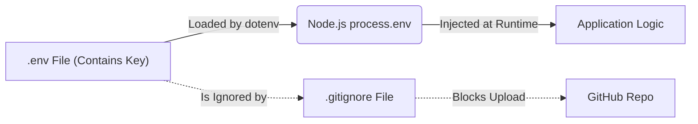

# SETTING UP THE AI DEVELOPMENT ENVIRONMENT

**Session Time:** 120 minutes 

---

## Table of Contents

1. The AI-Ready Workspace
2. Secure Environment Management
3. API Authentication Fundamentals
4. Testing Connections with Postman
5. Lab: Connecting to the OpenAI API
6. Wrap-Up and Reflection
7. Resources

---

## Learning Objectives

By the end of this module, participants will be able to:

1. **Configure an AI-ready web development environment** by installing necessary runtimes (Node.js) and version control tools (GitHub). 
2. **Implement secure environment management** using `.env` files to protect sensitive credentials from public exposure. 
3. **Execute API authentication** by generating API keys and successfully testing endpoints using Postman. 


---

## Session Breakdown

| Segment | Topic | Duration (minutes) |
| --- | --- | --- |
| 1 | The AI-Ready Workspace | 20 |
| 2 | Secure Environment Management | 30 |
| 3 | API Authentication Fundamentals | 20 |
| 4 | Testing Connections with Postman | 20 |
| 5 | Lab: Connecting to the OpenAI API | 30 |

---

## 1. The AI-Ready Workspace

Before writing code that "thinks," we need a foundation that can "speak" to AI services. A standard static web server isn't enough; we need a runtime environment that can execute server-side logic to keep credentials safe.

### Key Components

* **Node.js (The Runtime):** Allows us to run JavaScript outside the browser. This is critical for creating the "Server" layer discussed in the previous module, which acts as the secure bridge to AI APIs. 


* **npm (Node Package Manager):** Used to install libraries (SDKs) provided by AI companies (e.g., `openai` package) that simplify complex API calls.
* **Git & GitHub:** Essential for version control. In AI development, careful Git usage is vital to ensure you don't accidentally publish your secret API keys to the world. 


### Example: Initializing a Project

Instead of just an `index.html`, an AI project starts with a `package.json` file to manage dependencies.

```bash
mkdir my-ai-app
cd my-ai-app
npm init -y

```

---

## 2. Secure Environment Management

One of the most critical skills in AI development is **Environment Variable Management**. AI providers charge for access using "API Keys." If a hacker finds your key, they can use your quota, costing you money.

### The `.env` File Workflow

We never hardcode keys directly into JavaScript files. Instead, we use "Environment Variables"—values that exist in the system's background, injected into the app only when it runs.

1. **Create a `.env` file:** This file stores secrets as key-value pairs.
2. **Install `dotenv`:** A library that reads the `.env` file and loads variables into Node.js.
3. **Update `.gitignore`:** This is the most important step. You must tell Git to **ignore** the `.env` file so it is never uploaded to GitHub.

### Diagram: The Secure Key Flow



### Example Code

**Bad Practice (Insecure):**

```javascript
const apiKey = "sk-12345abcdef"; // NEVER DO THIS

```

**Good Practice (Secure):**

```javascript
// In .env file:
// OPENAI_API_KEY=sk-12345abcdef

// In server.js:
require('dotenv').config();
const apiKey = process.env.OPENAI_API_KEY; 

```

---

## 3. API Authentication Fundamentals

Accessing an AI model is not like visiting a public website. It requires **Authentication** (identifying who you are) and **Authorization** (confirming you have permission/credits to use the model).

### The Bearer Token

Most AI APIs (like OpenAI) use a standard HTTP header called the **Authorization Header** with a "Bearer Token." Think of this like a VIP pass. You don't enter a username/password for every request; you simply show the token.

### Structure of an Authenticated Request

When making a request, the header must look like this:

```
Authorization: Bearer <YOUR_OPENAI_API_KEY>
Content-Type: application/json

```

### Example: Generating a Key

1. Log in to the AI provider's developer dashboard.
2. Navigate to "API Keys."
3. Click "Create new secret key."
4. **Copy it immediately**—you won't be able to see it again.

---

## 4. Testing Connections with Postman

Before writing complex code, developers use tools like **Postman** to test if their API Key works and if the AI service is responding. This isolates "connection issues" from "coding errors." 

### Why Postman?

* **Immediate Feedback:** See the exact JSON response from the AI.
* **No Code Required:** You can verify your credit balance or model availability without writing a single line of JavaScript.
* **Debugging:** If Postman works but your app doesn't, the error is in your code, not the key.

### Setup Steps

1. Create a new `POST` request.
2. Enter the URL: `https://api.openai.com/v1/chat/completions`.
3. Under the **Auth** tab, select "Bearer Token" and paste your key.
4. Under **Body**, select "raw" (JSON) and enter a test payload.

---

## 5. Lab: Connecting to the OpenAI API

Refer: [**Connecting to the OpenAI API**](https://github.com/ga-curriculum/lab2-connecting-to-the-openai-api)

---

## 6. Wrap-Up and Reflection

**Reflection:**

1. Why do we add `.env` to `.gitignore`? What would happen if we pushed it to GitHub?
2. Why is it better to test with Postman before writing the full application code?

---

## 7. Resources

* [Node.js Download](https://nodejs.org/)
* [Postman Download](https://www.postman.com/downloads/)
* [OpenAI API Keys](https://platform.openai.com/api-keys)
* [NPM dotenv package](https://www.npmjs.com/package/dotenv)